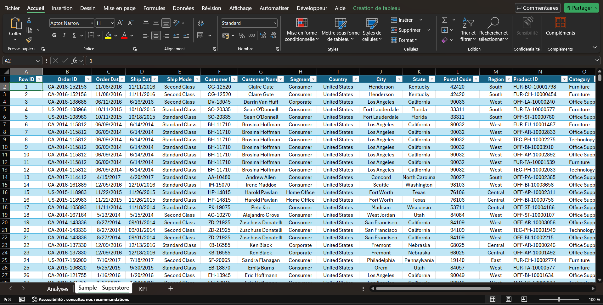
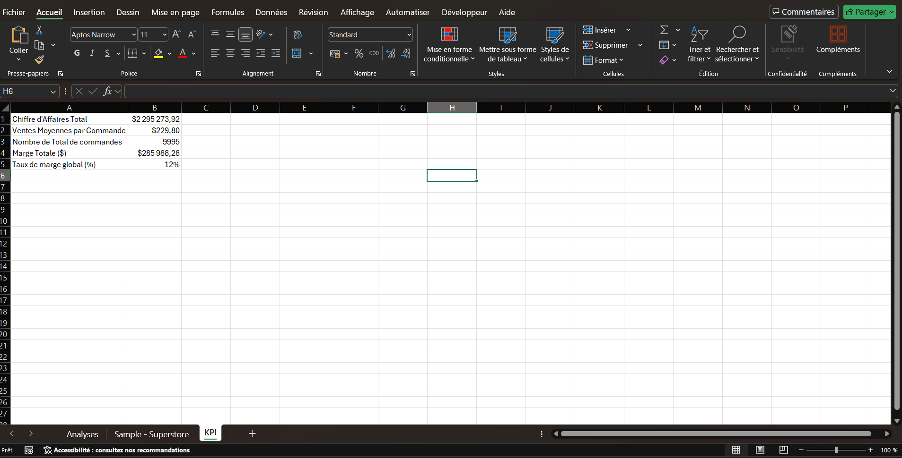
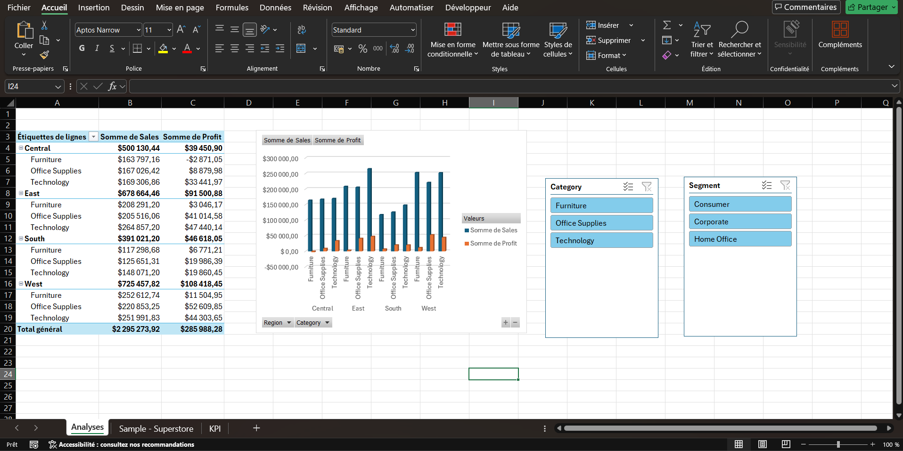

# 📊 Projet d'Analyse des Ventes

## 🎯 Contexte du projet
Ce projet a pour objectif d'analyser une base de données de ventes afin d'identifier les tendances clés, d'optimiser le suivi des performances et de concevoir un tableau de bord décisionnel clair et actionnable.

## 🛠️ Outils et compétences mobilisés
* **Outil :** Microsoft Excel (Nettoyage de données, tableaux croisés dynamiques, formules avancées).
* **Compétences :** Traitement de données brutes, structuration d'indicateurs de performance (KPI), visualisation de données.

## 📂 Contenu du dépôt
* `Base de donnée projet 1.xlsx` : Le fichier source contenant les données nettoyées et les calculs.

## 📈 Résultats & Insights clés
* Mise en place d'un tableau de bord synthétique permettant de suivre l'évolution des ventes.
* Identification des axes d'amélioration pour la stratégie commerciale.
## 📷 Aperçu du Projet

### 1. Données brutes / structurées

### 2. Indicateurs clés (KPI)

### 3. Tableau de bord final

